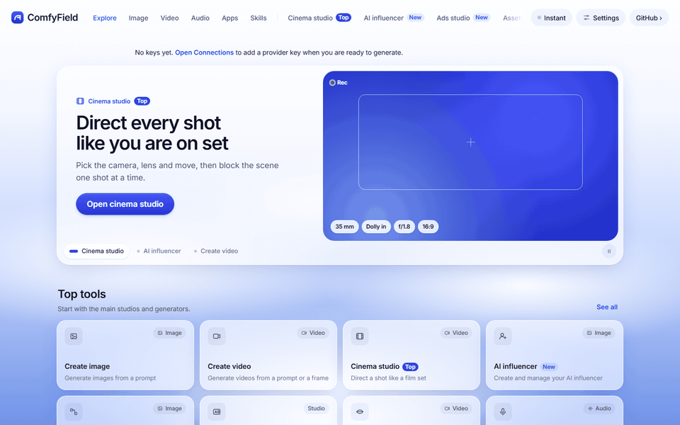
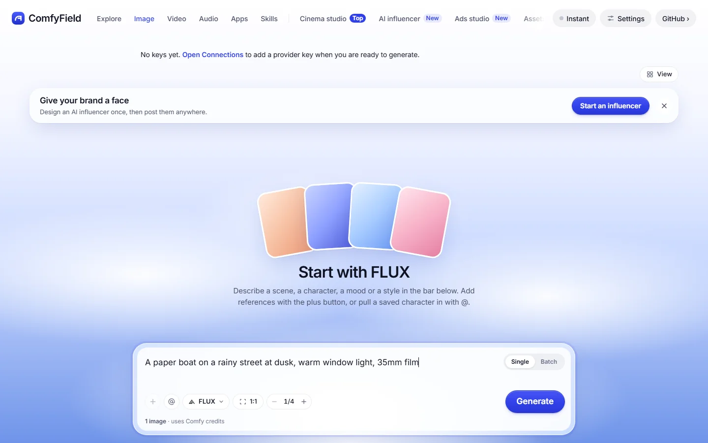
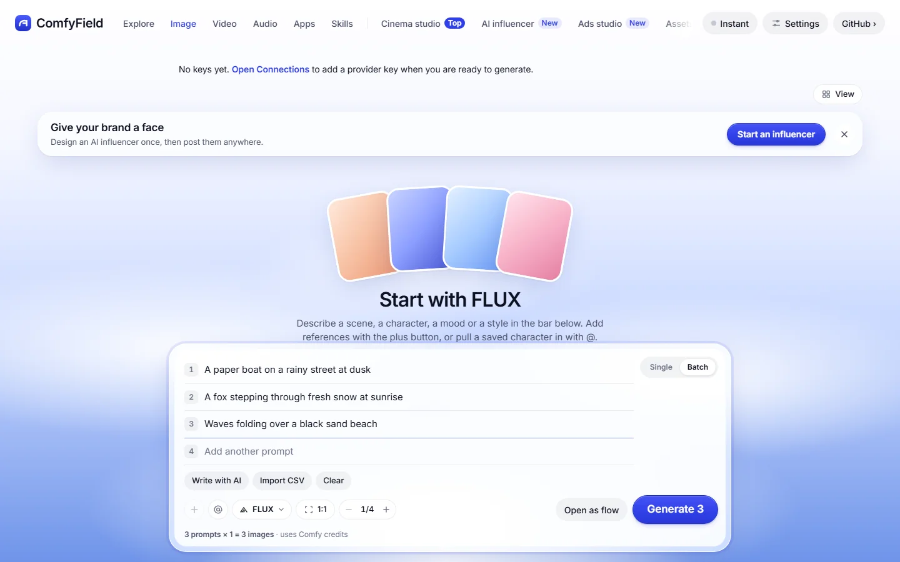
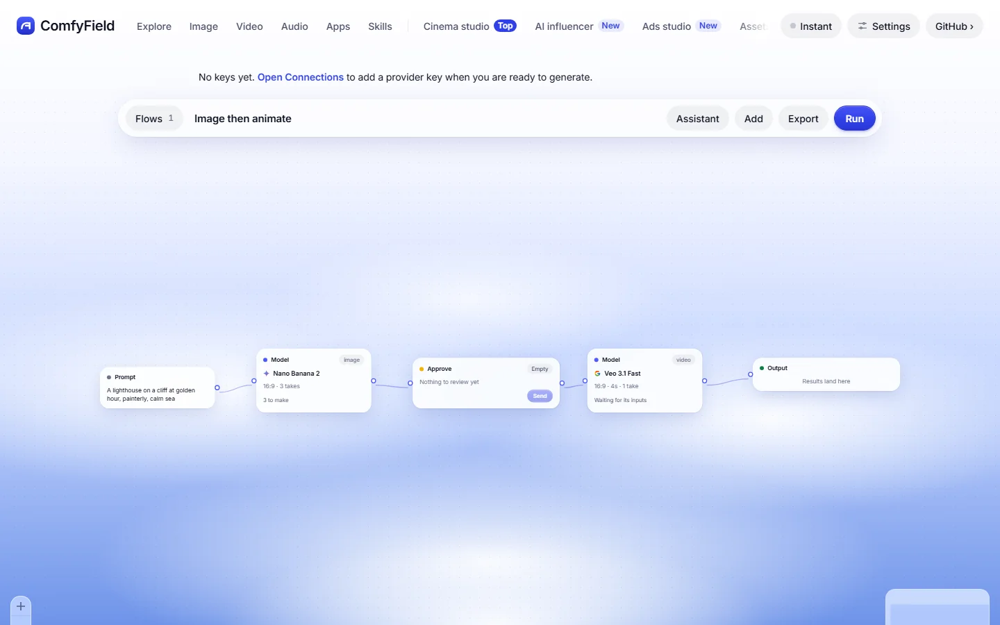
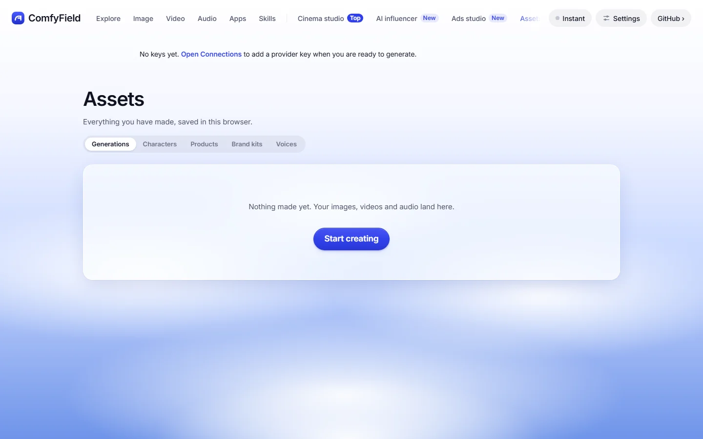
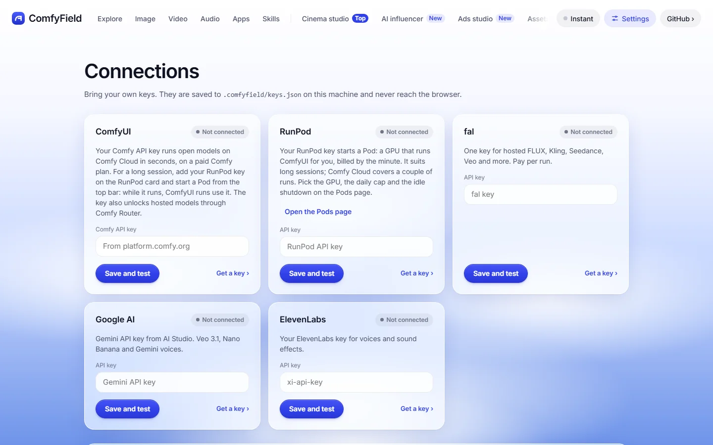
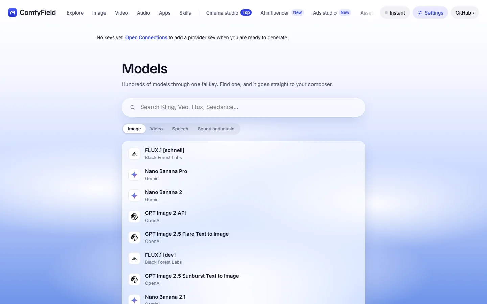
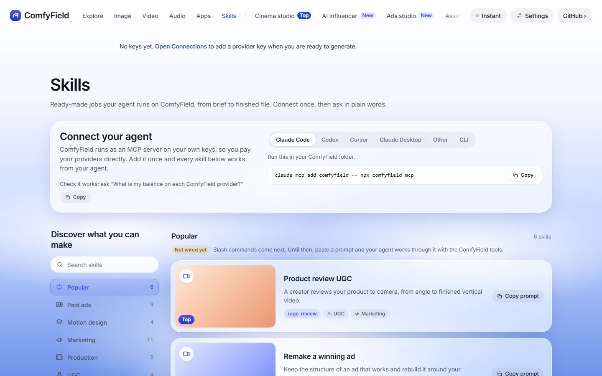

# ComfyField

ComfyField is an open-source creative studio that runs on your own computer. It makes images, video and audio with open models on Comfy Cloud, hosted models through Comfy Router, and other providers with your own keys. It follows Higgsfield's layout: one composer to make things, a canvas to chain steps, a library for results, and an MCP server so any agent can use the same studio. There is no ComfyField account and no markup: you pay each provider directly. You do not need a GPU.

Built for the [Open Source Higgsfield](https://comfy.org/open-source-higgsfield) competition on the Comfy Developer Platform.



The clip shows the real app with no keys connected, so it shows no generated media yet. Example outputs come with [#9](https://github.com/ergophobian/comfyfield/issues/9) and the demo video with [#14](https://github.com/ergophobian/comfyfield/issues/14).

## Set it up in five steps

1. Install [Node.js 22 or newer](https://nodejs.org/en/download), then reopen your terminal.
2. Get the code:
   ```bash
   git clone https://github.com/ergophobian/comfyfield.git
   cd comfyfield
   ```
3. Start it with `npm start` (`npm.cmd start` on restricted PowerShell). The first start installs dependencies, builds the app and opens your browser at `http://127.0.0.1:5173`.
4. Get a Comfy API key at [platform.comfy.org](https://platform.comfy.org/profile/api-keys). Comfy Cloud workflows need a paid Comfy plan; Comfy Router models use Comfy credits.
5. Open **Connections**, paste the key into the **ComfyUI** card and click **Save and test**. Then open **Image** and generate.

Starting and browsing spend nothing. Add fal, Google AI, ElevenLabs or RunPod keys in Connections only if you want them. Keys are saved on your machine and only the local server reads them. The [setup guide](docs/setup.md) covers macOS, Windows and Linux, the data folder, ports and common fixes.

## Feature tour

### Create



**Image**, **Video** and **Audio** each open one composer. Type a prompt, pick a model, an aspect ratio and a count, then click **Generate**. Add reference images with the plus button, or pull in a saved character with @. The note under the bar shows the estimated cost, or which credits the run uses, before you run it.

### Batch



Switch the composer from **Single** to **Batch** to run a list of prompts at once. Paste several lines, import a CSV, or click **Write with AI** to get six prompts from one idea (this uses your Google AI key). The bar shows the total, such as 3 prompts × 1 = 3 images. **Open as flow** turns the batch into a flow on the canvas.

### Flows



**Flows** is a node canvas for multi-step work: prompts, model nodes, Approve gates, Stitch and outputs. Start from a starter flow such as Image then animate, or add nodes yourself. The rules are strict so a paid step never re-runs by accident:

- An Approve node holds everything downstream until you click **Send**.
- **Run** fills gaps only; a model node with output re-runs only through its own **Rerun**.
- **Regenerate all** wipes outputs and runs everything again.

A **Stitch** node joins clips, trims them, burns in captions and adds music, all locally with ffmpeg and no paid calls. See [Stitch clips locally](docs/stitch.md).

### Library



**Assets** keeps everything you make, saved in this browser. It also holds characters, products, brand kits and voices that you can reuse in prompts. Training a character model is not wired yet.

### Models and connections



**Connections** has one card per provider, each with **Save and test** and a link to get a key. **Models** searches fal's catalog of hosted models; pick one and it goes straight to the composer. Pinned open models such as FLUX 3 Klein, Qwen-Image 2.1, LTX-2.5, Wan 2.2 and MiniMax H3 run as ComfyUI workflows.



### Agents (MCP)



ComfyField ships an MCP server and a CLI that use the same keys and the same generation code as the app. **Skills** shows the setup for Claude Code, Codex, Cursor and Claude Desktop, and 25 ready-made jobs with a prompt to copy. The skills' slash commands are not wired yet, so you paste the prompt. See [Use from your agent](#use-from-your-agent).

### Apps, effects and presets

**Apps**, **Effects** and **Motion presets** list 450 one-click formats. Each format is a saved set of inputs on one model: 438 run as bundled ComfyUI workflows in `public/workflows/`, and 12 run on fal. Studio pages that are not ready show "Not wired yet".

## What runs on Comfy

All ComfyUI work goes through the Comfy Developer Platform with your Comfy API key. Nothing runs ComfyUI on your own GPU.

| Part | Comfy service | How |
| --- | --- | --- |
| Open models in the composer (FLUX, SDXL, Z-Image Turbo, HiDream-O1, Qwen-Image Edit 2511, LTX Video, LTX-2.5, Wan 2.2, MiniMax H3) | Comfy Cloud | The app fills a bundled API-format workflow and runs it with the Comfy SDK (`@comfyorg/sdk`). Results are saved to your data folder. |
| The ComfyUI formats in Apps, Effects and Motion presets, and ComfyUI model nodes in Flows | Comfy Cloud | Same path as above. A format that needs a model or node pack Comfy Cloud lacks runs on a Pod. |
| Flux 2 Pro and Seedance 2.5 | Comfy Router | `runComfyRouter` posts to `api.comfy.org/v2/models/<provider>/<model>/requests` with an idempotency key and polls for the result. These models show in the picker once a Comfy key is saved. |
| Testing the key in Connections | Comfy Cloud | One read-only account request. It never generates. |
| Models Comfy Cloud does not have yet (FLUX 3 Klein, Qwen-Image 2.1) and long sessions | A Pod | ComfyUI on your own RunPod GPU, driven by the same Comfy SDK. Set a daily cap and idle shutdown on the **Pods** page. Pick **Instant** (Comfy Cloud) or **Session** (Pod) in the top bar. |

Other providers are optional and use your own keys: fal (hosted image, video, speech and music models), Google AI (Veo 3.1, Nano Banana, Gemini voice, and AI prompt writing) and ElevenLabs (voices and sound effects). The code for every provider is in [`server/core.js`](server/core.js).

## Use from your agent

The MCP server and the CLI read the keys you saved in Connections. Nothing is billed by ComfyField.

From a clone, point your agent at the CLI in this folder:

```bash
claude mcp add comfyfield -- node /path/to/comfyfield/bin/comfyfield.js mcp
```

After the npm package is published, the same works with `npx comfyfield mcp`; the Skills page shows the config for each agent.

MCP tools: `list_models`, `generate`, `get_model_schema`, `balance`, `write_prompts`, `stitch`, `export_stitch`, `list_flows`, `get_flow`, `create_flow`, `add_node`, `connect_nodes`, `update_node`, `remove_node` and `run_flow`. Any fal endpoint works as `fal:<endpoint>`. Flows an agent builds are saved in your data folder, so the app shows them. `run_flow` fills gaps only and never opens an Approve gate; only you press Send in Flows. See [docs/flows-mcp.md](docs/flows-mcp.md).

CLI:

```bash
node bin/comfyfield.js models --kind video
node bin/comfyfield.js connect comfy --key <your Comfy API key>
node bin/comfyfield.js generate "a fox in fresh snow, dolly in" --model comfy-ltx25 --ratio 16:9 --duration 5 --out ./renders
node bin/comfyfield.js balance
```

`generate` spends credits and prints an estimated cost first. Run `node bin/comfyfield.js --help` for every option. The CLI never starts a Pod.

## How it works

- [`server/core.js`](server/core.js): the generation engine and every provider. The app, the CLI and the MCP server share it.
- [`server/plugin.js`](server/plugin.js): the local HTTP API inside the app server.
- [`shared/mapping.js`](shared/mapping.js): maps composer settings onto each model's inputs, and estimates cost.
- [`src/lib/catalog.js`](src/lib/catalog.js): the pinned models and provider cards.
- [`src/lib/flowEngine.js`](src/lib/flowEngine.js): the Flows rules, checked by `scripts/flow-checks.mjs`.
- [`public/workflows/`](public/workflows): ComfyUI workflows in API format with `{{placeholders}}`.

To add a ComfyUI model, export a workflow with "Save (API)", swap in placeholders such as `{{prompt}}`, `{{seed}}`, `{{width}}` and `{{height}}`, and add an entry to the catalog.

## Contributing

Read [AGENTS.md](AGENTS.md) and [CONTRIBUTING.md](CONTRIBUTING.md). People and coding agents follow the same rules. Before a PR, run:

```bash
npx vite build
node scripts/verify.mjs
```

## License and credits

ComfyField is released under the [MIT License](LICENSE).

The optional `ffmpeg-static` package and the ffmpeg binaries it downloads have their own licenses, including the GPL. They are not covered by the MIT License. See [NOTICE.md](NOTICE.md). The caption font, Noto Sans, is under the [SIL Open Font License](server/fonts/OFL.txt).

Credits:

- [ComfyUI](https://github.com/Comfy-Org/ComfyUI), Comfy Cloud, Comfy Router and the [Comfy SDK](https://docs.comfy.org/development/api-development/sdks) by Comfy Org.
- Higgsfield, whose product structure ComfyField follows. ComfyField uses its own theme, copy and media.
- PatchWork, whose workflow spec gives Flows its Approve, Send and Run rules.
- [FreeVideo](https://github.com/FlashML-org/FreeVideo), which runs MiniMax H3 on a Pod.
- The open model authors: Black Forest Labs (FLUX), Alibaba Qwen, Alibaba Tongyi, Alibaba Wan, Lightricks (LTX), MiniMax, HiDream, Stability AI, ByteDance, MeiGen, Resemble AI and Fish Audio.
- [React](https://react.dev), [React Router](https://reactrouter.com), [React Flow](https://reactflow.dev), [Vite](https://vite.dev), the [MCP TypeScript SDK](https://github.com/modelcontextprotocol/typescript-sdk), [Zod](https://zod.dev) and [ffmpeg](https://ffmpeg.org).
