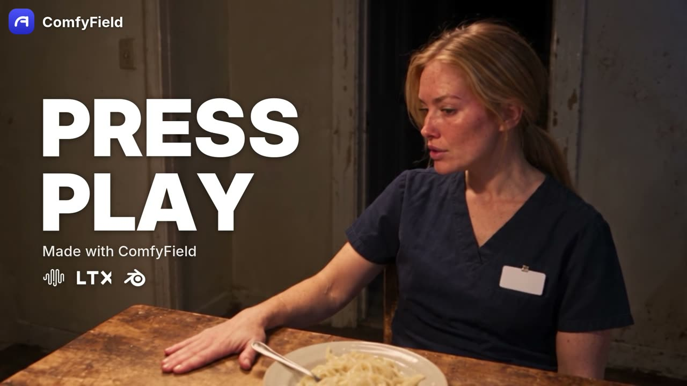

# ComfyField

Formats that earn.

Insert your product, pick a proven viral format, post on schedule. ComfyField is an open-source studio for short-form video, images and audio. It runs on your computer, with your own keys, on the Comfy Developer Platform. Built for [Open Source Higgsfield](https://comfy.org/open-source-higgsfield).

**Site:** https://comfyfield.com

<a href="https://comfyfield.com/#film-section"></a>

**Press play**, a short film made by the ComfyField team with MiniMax, LTX and Blender: [watch on comfyfield.com](https://comfyfield.com/#film-section) · [download the MP4](site/assets/film.mp4)

<!-- DEMO VIDEO -->
**Demo video (2 min):** [watch on comfyfield.com](https://comfyfield.com/#demo) · [download the MP4](site/assets/demo.mp4)

## How it works

1. **Insert your product.** Write one line: what you sell and who it is for. Add a product photo or a character if you have one.
2. **Pick a format.** The format's writer layers its proven structure on top of your line. You read and edit the plan before anything renders.
3. **Approve the cheap frame, then render.** Each video format makes a still with Flux 2 Pro first and waits at an approval gate. Only an approved frame becomes a Seedance 2.5 clip, with sound. Series formats do this per beat and join the clips in order.
4. **Queue and schedule.** Every output lands in the Library. Keep an idea queue per channel in Assets, and schedule posts to your channels with [Postiz](docs/postiz.md).

## The formats

22 formats in five families, first on Explore and on Apps under **Formats that earn**. All are vertical (9:16).

| Family | Formats |
| --- | --- |
| Product ads and UGC | Chaotic product story, Problem mascot, Before and after reveal, Ingredient parade, Unboxing hook, Price knockout, Rated carousel |
| Faceless series | What if, Countdown list, Science narrator, Timeline transformation, Big question |
| Drama shorts | Object drama, Challenge vlog, Hero and villains |
| AI influencer | Influencer character sheet, Put them in a trend, Influencer from scratch, Influencer product post |
| 3D explainers | Body part explainer, Object explainer, Tiny worker |

Writers use only the facts you give: no invented prices, reviews, results or health claims, and no real people or other brands. Formats are plain data in [src/lib/formats/earn.js](src/lib/formats/earn.js), so you can add your own in a few lines, or share and import one as a file. Each format, its shape and how to write a new one: [Formats that earn](docs/formats-that-earn.md).

## Let your agent run it

Claude Code, Codex or any MCP client can fill each channel's idea queue, write and generate, run flows and schedule posts. Flows stop at every Approve gate; only you can press Send. In your comfyfield folder:

```sh
claude mcp add --scope user comfyfield -- node "$PWD/bin/comfyfield.js" mcp
```

For Codex, run the same line with `codex mcp add comfyfield`. Other clients run `node bin/comfyfield.js mcp` with the full path to the file.

- Queue and posting: `queue_add`, `queue_list`, `queue_update`, `queue_remove`, `postiz_channels`, `schedule_post`
- Making: `write_prompts`, `generate`, `list_models`, `get_model_schema`, `balance`, `stitch`, `export_stitch`
- Flows: `list_flows`, `get_flow`, `create_flow`, `add_node`, `connect_nodes`, `update_node`, `remove_node`, `run_flow`
- Teamwork: `list_agents`, `assign_agent`, `my_tasks`

The same features are on the command line:

```sh
node bin/comfyfield.js channels
node bin/comfyfield.js queue list
node bin/comfyfield.js models --kind video
node bin/comfyfield.js --help
```

See [Flows through MCP](docs/flows-mcp.md) and [Postiz setup](docs/postiz.md).

## Costs

You pay only your own provider credits; ComfyField bills nothing. Every video format stops for your approval of a cheap still before the paid clip renders. Prices in the app are estimates. Connections has an optional spend cap that asks before a run takes this session past it.

## Start

1. Install [Node.js 22 or newer](https://nodejs.org/en/download) and [Git](https://git-scm.com/downloads), then reopen your terminal.
2. Paste these three lines. `npm start` installs everything, builds the studio and opens it in your browser. The first start takes a few minutes.

   ```sh
   git clone https://github.com/ergophobian/comfyfield.git
   cd comfyfield
   npm start
   ```

3. Open **Connections**, paste a key from [platform.comfy.org](https://platform.comfy.org/profile/api-keys) into the **ComfyUI** card and choose **Save and test**.

Or ask your agent: "Clone github.com/ergophobian/comfyfield and run it with npm start."

On Windows PowerShell, the last line is `npm.cmd start`. Data folders, ports and fixes: [setup guide](docs/setup.md). Developers can use `npm run dev` for live reload.

## How it uses Comfy

One Comfy key covers both paths. The app, CLI and MCP server share them through [server/core.js](server/core.js).

- **Comfy Router API v2.** Every format runs here: Flux 2 Pro for frames and slides, Seedance 2.5 for clips. `GET https://api.comfy.org/v2/models` lists hosted models. A run posts to `/v2/models/{provider}/{model}/requests` with `X-API-Key` and an `Idempotency-Key`, polls `/requests/{id}/status`, then fetches `/requests/{id}` for the result. [shared/mapping.js](shared/mapping.js) maps the composer's settings onto each model's inputs.
- **Comfy SDK on Comfy Cloud.** `@comfyorg/sdk` loads a bundled API-format workflow from [public/workflows](public/workflows) with `client.workflows.fromFile`, attaches uploads with `client.assets.fromBytes`, waits for the job and saves its outputs to the Library. The LTX-2.5 graphs behind Cinema run this way. The same runner can target your own RunPod Pod for long sessions.

Optional keys add fal, Google AI, ElevenLabs, RunPod and Postiz.

## The rest of the studio

- **Cinema** turns one idea into a 2 to 6 shot scene with LTX-2.5 on Comfy Cloud. Approve or rerun each shot, then stitch. See [Cinema on LTX-2.5](docs/cinema-ltx.md).

  | Shot 1 | Shot 2 | Shot 3 |
  | --- | --- | --- |
  | [](site/assets/shot1.mp4) | [](site/assets/shot2.mp4) | [](site/assets/shot3.mp4) |

- **Create** images, video and audio from one composer with any connected model.
- **Flows** chain prompts, models, Writer nodes and Stitch on a canvas, with Approve gates. Formats run on the same engine, and every Cinema scene is saved as a flow.
- **Library** (Assets) keeps every generation next to your characters, products, brand kits, voices and idea queue.
- **Stitch** joins clips locally with trims, captions and music, at no cost. See [Stitch](docs/stitch.md).

Multi-part runs, such as long speech or long video, show "not available yet". Use one segment or a short script per run.

## Docker

On a home server, `docker compose up -d` serves the studio at http://localhost:5173 with data in a named volume. See [Docker](docs/docker.md).

## Contributing

Read [AGENTS.md](AGENTS.md) and [CONTRIBUTING.md](CONTRIBUTING.md) before you pick up an issue.

## License

[MIT](LICENSE). Third-party licenses for ffmpeg, model weights, node packs and provider logos are in [NOTICE.md](NOTICE.md).
