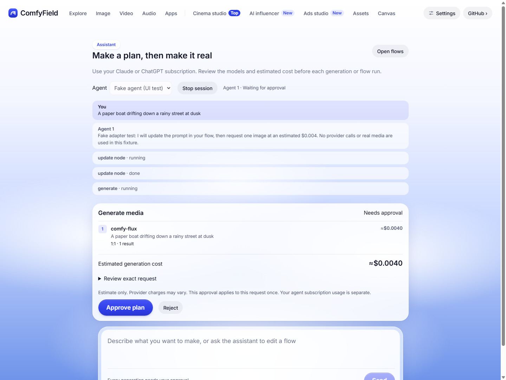
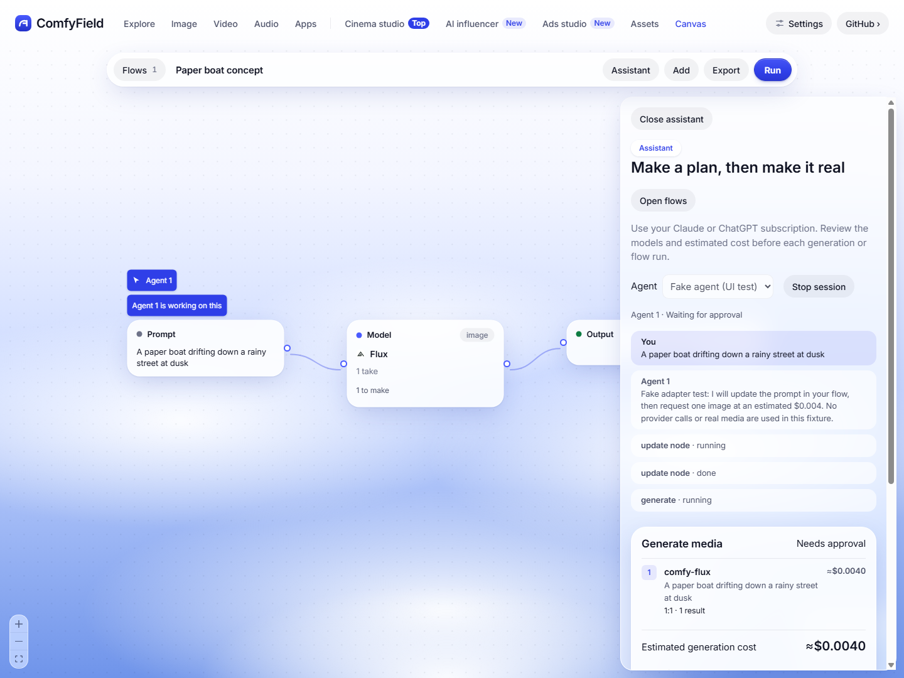
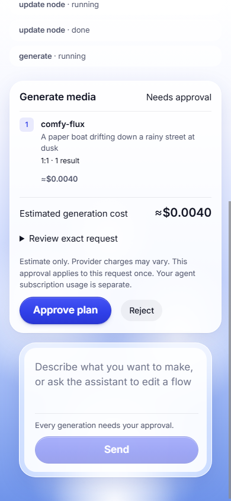
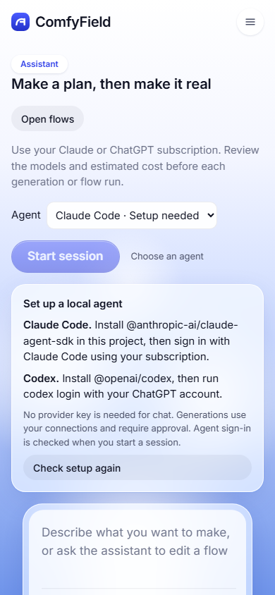

# Agent harness (#51)

The Assistant page and the Assistant panel in Flows use the same local server session. Install an agent, sign in through its own client, start a session, then send a brief. Review each generation or flow plan before approving it. Flow editing itself needs no generation approval.

## Setup

- Claude: install `@anthropic-ai/claude-agent-sdk` in this project with `npm install @anthropic-ai/claude-agent-sdk`, then sign in through Claude Code. The SDK is loaded dynamically; its absence leaves the app usable and shows setup instructions.
- Codex: install `@openai/codex` with `npm install -g @openai/codex`, then run `codex login` with your ChatGPT account. Windows npm launchers and native executables are supported.
- Use the app on `http://localhost:<port>` or `http://127.0.0.1:<port>`. Harness and flow routes accept loopback connections only.

Availability checks detect installed software. Authentication is checked by the agent when a conversation begins. No provider API key is passed to the agent process. Generations still use the existing provider configuration in `server/core.js`.

## Interfaces

`server/agent-adapters.js` exposes a small adapter contract: `factory({ emit, mcp }) -> { send(text), stop() }`. `send` resolves when a turn ends. `emit` accepts message, tool and error events. The harness owns status, plans, approvals and presence, so another adapter can reuse those behaviors.

Claude uses the Agent SDK with built-in tools disabled and the ComfyField MCP bridge attached. Codex uses newline-delimited app-server requests: initialize, thread/start, turn/start and item/turn notifications. It disables shell tools and apps, uses a read-only sandbox, and declines command, file and permission approvals. Model turns are never launched during automated checks.

Each attached MCP process forwards tools to the owning session with an ephemeral token. Tokens stay out of browser responses and events. Existing tools plus `list_flows`, `get_flow`, `add_node`, `connect_nodes`, `update_node` and `run_flow` are registered by `server/mcp.js`. Standalone `comfyfield mcp` retains its existing direct generation behavior; the approval gate applies to Assistant sessions.

| Route | Purpose |
| --- | --- |
| `GET /api/agents/setup`, `GET/POST /api/agents` | Inspect setup, list sessions, start a session |
| `GET /api/agents/events` | SSE notifications for session activity, presence and flow changes |
| `POST /api/agents/:id/message`, `/approve`, `/stop` | Chat, decide a one-use plan, stop a session |
| `POST /api/agents/:id/tool` | Session-token-protected MCP bridge |
| `GET/PUT /api/flows` | Read or save shared flows with revision checks |
| `POST /api/flows/:id/action` | Run the existing flow engine or perform a gate/node action |

Flows and completed run state live in `.comfyfield/flows.json`. The first visit imports browser flow definitions and saved run state if the server store is empty. The browser retains pure planning methods but sends execution and gate actions to the server. The server preserves the browser's fal image-endpoint routing and forwards reference images to Google. No changes were made to `flowEngine.js`.

Concurrent definition edits fail with a conflict instead of overwriting one another. The app retains the unsaved flow for export and offers Reload flows. Running flows reject edits. A flow plan freezes the definition and run state: either changing before approval requires a fresh plan. The dry run follows the existing gates and records the allowed generation calls; additional calls beyond that plan are refused.

Each `generate`, `write_prompts` or `run_flow` call requires its own approval. Estimates use `core.estimateCost`; unavailable prices are shown explicitly. Approval is not a provider price guarantee. Stopping invalidates pending plans, denies further tools and stops the agent. Provider work already submitted can still finish; stopping does not cancel the provider's job. Ended or failed agent turns also invalidate unanswered plans.

## Verification

`node scripts/agent-checks.mjs` runs in CI on Windows, macOS and Linux. It injects fake generation and estimates, tests Claude/Codex protocol adapters, approval/rejection/expiry/stop, stale plans, shared persistence, flow gates, local route checks, and the actual HTTP/SSE plus stdio MCP bridge. Fixtures stay under ignored `.comfyfield/agent-checks/`. No provider calls are made.

For browser verification, build the app and run the check:

```sh
npx vite build
node scripts/agent-ui-checks.mjs
```

The check starts its own fixtures on free ports and one fresh headless Chrome profile, checks desktop and 390px layouts, approves a fake generation, verifies presence and stop, recovers from conflicting edits, checks missing-agent setup, and captures the PNGs in this directory. Set `CHROME_PATH` if Chrome is elsewhere. These fixture adapters are injected only by the test script and are unavailable in the normal app. For manual inspection, `node scripts/agent-ui-fixture.mjs` and its `--setup-only` variant still serve ports 5317 and 5318.

The screenshots show fake-adapter UI activity or simulated missing-agent setup. They contain no generated media. The installed Codex CLI's generated protocol schema was inspected locally with version 0.159.2; live subscription conversations, provider estimates and real media generation remain unverified. Spend: $0.

Session history and approvals live in server memory and do not survive restarting the app server. Flows and run results do survive. One active session is supported. No format-runner, prompt-writer, input-widget, Router/Cloud or Stitch interfaces from the parallel lanes are required by this change.

Protocol references: [OpenAI app-server documentation](https://learn.chatgpt.com/docs/app-server), [OpenAI configuration reference](https://learn.chatgpt.com/docs/config-file/config-reference), [Claude SDK MCP documentation](https://code.claude.com/docs/en/agent-sdk/mcp).

## Screenshots

Desktop plan and canvas presence (fake adapter):





390px plan and missing-agent setup:




