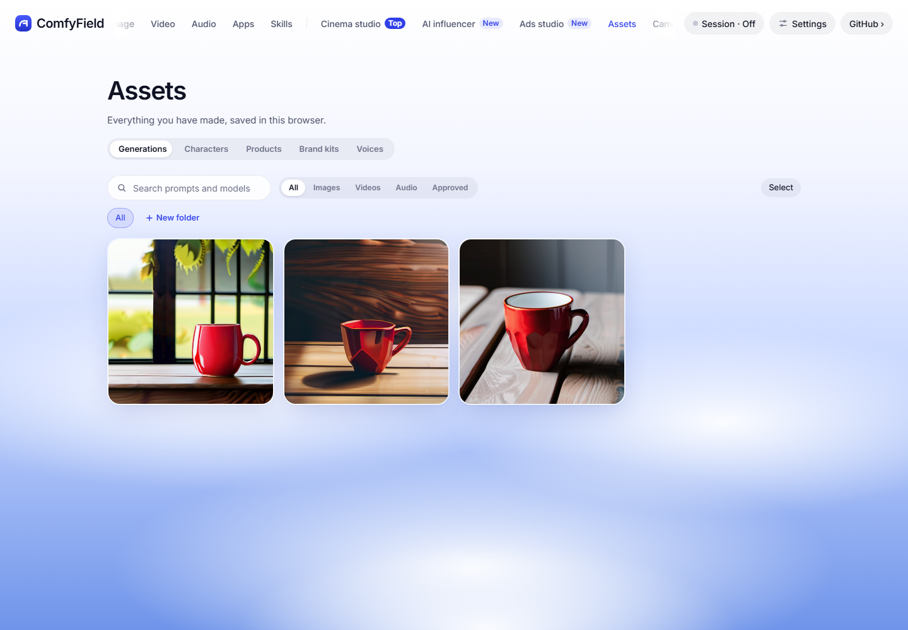

# Live run results, 2026-10-25

Refs #71. Approved budget: $15 in total for this task (owner approval, 2026-10-25). Spend: **$0.496485**, all on RunPod. Every paid step went through `scripts/live-run.mjs` and has a row in [ledger.jsonl](ledger.jsonl). The costs in the ledger are RunPod's billed amounts (`GET https://rest.runpod.io/v1/billing/pods?podId=...`, read at 22:20 UTC), not estimates.

## Summary

| Issue | Step | Outcome | Spend |
| --- | --- | --- | ---: |
| #71 | Pod: start, SDXL twice, pause, resume, SDXL once more, idle terminate | Passed | $0.343397 |
| #71 | Pod: self-termination with the pod-scoped key (`podself`) | Passed | $0.153088 |
| #71 | Comfy Cloud: FLUX schnell image + LTX-2.5 clip | Not run: no Comfy key | $0 |
| #71, #1 | Comfy Router: Photon Flash image, cheapest Router video | Not run: no Comfy key | $0 |
| #3, #5 | LTX-2.5 clip on Comfy Cloud at the app size, README example | Not run: no Comfy key | $0 |
| #28 | Authenticated Router catalog, Soul image | Catalog not read: no Comfy key. Public pricing page read (see below) | $0 |
| #34 | One run per effect runtime path | Not run: every path is Comfy Cloud or Router | $0 |
| #9 | Real covers | Not run: needs Cloud or Router outputs | $0 |
| | **Total** | | **$0.496485** |

The task brief said the worktree's `.comfyfield/keys.json` held the Comfy key. It holds only `comfy.run` and the RunPod key; the owner's checkout has the same. No `.env` exists. As AGENTS.md asks, no key was read from the shell environment. Every Comfy step is ready to run with the existing harness once a Comfy key is saved in Connections.

## Pod proof (`node scripts/live-run.mjs pod --allow-paid --cap 15`)

- GPU: RTX PRO 4000, Secure cloud, $0.57 an hour (first in-stock ladder rung for SDXL). Volume 120 GB, container disk 50 GB.
- Pod `pv3fggq560hs7q`, created 18:13:55 UTC. Absolute proof deadline 18:58:54 UTC.
- Start to ready: **257.7 s** (boot, ComfyUI, `sd_xl_base_1.0` download included in the first run).
- SDXL run 1: 45.0 s. Run 2: 6.1 s (model warm).
- Pause, then resume to ready: **70.3 s**.
- Model survived pause: **yes**. `checkpoints/sd_xl_base_1.0.safetensors` was on `/workspace` before any new download was possible.
- SDXL run 3 after resume: 49.5 s (cold load from the volume).
- Idle terminate: **fired**, from the app-side guard, with the event "Terminated after 10 idle minutes." The ten minutes are the Pod's own idle counter (`idleSec` from the status server).
- Billed: 2064 s of running time, **$0.343397**. The billed time puts the end at about 18:48:22 UTC. The harness exited at 18:48:23 UTC with code 0.
- The three images went into the Library through `core.saveToLibrary` and `/api/library/generations`.



Screenshot: the app from this worktree (`npm run dev -- --port 5791`), headless Chrome, `/assets`. These are real outputs, not mocks.

### Finding: the idle clock started late

The last run ended at about 18:22:08 UTC, but the Pod reported ten idle minutes only at about 18:48. That is about 26 minutes after the last run, not ten. In `server/pod-statusd.py`, `next_idle` sets the counter back to zero on any tick where GPU use is above 0, the ComfyUI queue is unknown, or a download is active. One short spike after a run (for example ComfyUI freeing memory) restarts the full ten minutes. The guard did fire, and the Pod did not run past its deadline, but users pay for the extra idle time. A follow-up could count idle with a small use threshold (for example below 5 %) or ignore one-tick spikes. This run does not change it.

## Self-termination proof (`node scripts/live-run.mjs podself --allow-paid --cap 15`)

- Pod `4if1j3466cy0w9`, RTX PRO 4000, $0.57 an hour, created 17:56:58 UTC, proof deadline 18:11:58 UTC.
- Start to ready: **237.2 s**. At ready, the status server reported `selfTerminateReady: true` (it has `RUNPOD_POD_ID` and RunPod's `RUNPOD_API_KEY` inside the container) and the expected deadline.
- The harness then only read the Pod: no heartbeat, no app-side guard, as if the app were closed. The outside guard was set five minutes past the deadline.
- The Pod was gone **19 s after its deadline** (919 s after create). The harness swept 0 Pods; the outside guard had not yet reached its time. So the Pod's own watchdog ended it through `kill-pod.sh` with the pod-scoped key.
- Which key the Pod sees: RunPod's own pod-scoped `RUNPOD_API_KEY`. The account key never leaves the client (checked in `scripts/live-run-check.mjs`: the create body has no account key).
- Billed: 912 s, **$0.153088**.

## Safety changes made before the paid runs

The account also held the owner's own Pods (`h8gfsxoy7c8f3t`, later `5r4n3f86blegei`, both `comfyfield-<time>`). The old harness had two problems with that:

1. `server/pod.js` adopts any `comfyfield-*` Pod when the checkout has no `pod.json`. The proof would have adopted the owner's Pod, and its idle guard could have terminated it. Now `podManager({ adoptPrefix })` limits adoption, and the harness sets `COMFYFIELD_POD_ADOPT_PREFIX=comfyfield-live-` for itself and its detached guard.
2. The empty-account checks and `sweep` covered every `comfyfield-*` Pod, so the proof would refuse to start, and `sweep` would end the owner's Pod. Now both cover only `comfyfield-live-*`. `sweep --all` keeps the old behaviour.

RunPod's quote now returns `availableGpuCounts: null` and a `stockStatus` level (`Low`, `Medium`, `High`). The quote read only the counts, so every GPU showed unknown stock and the harness refused to start. The quote now treats a stock level as in stock; counts still win when RunPod sends them.

The owner's Pod `5r4n3f86blegei` ended at about 18:10 UTC, during the `podself` run. This harness sent no request to it: every sweep, adopt and guard was limited to `comfyfield-live-`. RunPod's billing shows it ended on its own (most likely its 10-minute idle rule).

At the end: `GET /v1/pods` lists no Pods, and no guard process is running.

## #28: Higgsfield on Comfy Router (public data only)

The published [Router pricing page](https://docs.comfy.org/development/comfy-router/pricing) (read 2026-10-25) has Higgsfield as a provider, with three `higgsfield/*` models, all video:

- `higgsfield/higgsfield-genjutsu-motion-transfer-v1.0`: $0.45474/s at 480p, $0.97383/s at 720p, $2.33376/s at 1080p
- `higgsfield/higgsfield-kling-3-4k`: $0.42/s at 4K
- `higgsfield/higgsfield-kling-3-pro`: $0.168/s

It lists no Soul (image) model. The authenticated catalog (`GET https://api.comfy.org/v2/models`) needs the Comfy key and was not read. So a Soul image through Router is not possible from the public list. It may still exist in the authenticated catalog, or need open.higgsfield.ai.

The same page lists the cheapest Router video as `pruna/p-video-2` (Draft, 720p) at $0.02145/s. Next are `xai/grok-imagine-video-1-5-lite` (480p) and `veo/veo-3.1-lite-generate-001` (720p, no audio). Use one of these for #1's video proof.

## To finish with a Comfy key

Save the key in Connections in this worktree, then run, in this order:

```sh
node scripts/live-run.mjs router --allow-paid --cap 15
node scripts/live-run.mjs cloud --allow-paid --cap 15
```

Then #1's Router video, #3's full-size LTX clip, the #28 catalog read and the #34 and #9 runs. About $14.50 of the $15 approval remains.
