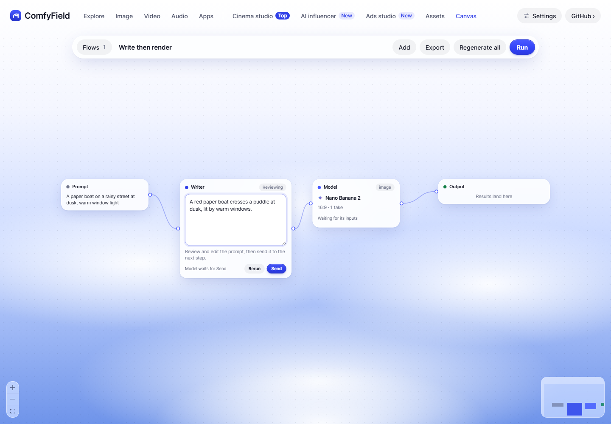
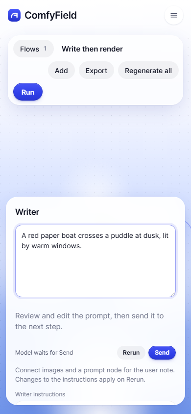

# Prompt writer interface

Issue #47 adds a native `writer` node to `createEngine`. The format runner in #46 can compile a `type: 'writer'` step into that node without introducing another execution path.

```js
const node = {
  id: 'writer',
  type: 'writer',
  position: { x: 0, y: 0 },
  data: {
    instructions: effect.writer_instructions,
    note: inputs.note || '',
    images: inputs.images || [],
    target: 'LTX video',
  },
}
```

`instructions` is required. The other fields are optional. Images are ordered strings containing uploaded `/media/...` URLs or base64 image data URLs. Google supports PNG, JPEG, WebP and GIF here. Remote URLs and SVGs are rejected; upload images locally first. The research's per-effect `writer_instructions` strings pass in unchanged.

Alternatively, connect prompt nodes for notes and image nodes for references. All connected inputs must be ready. Notes append to `data.note`; reference images append to `data.images` in edge order. To also give the render model the reference image, connect its image node to the render model separately.

Inject `writePrompt` into `createEngine({ run, writePrompt })`. The browser implementation is exported from `src/lib/providers.js`; `engineFor` already injects it. Server callers can inject `core.writePrompt` directly. Both resolve to a single text string:

```js
await core.writePrompt({ instructions, note, images, target }) // string
```

The local HTTP equivalent is `POST /api/prompt` with that JSON body, returning `{ text }`. It uses the saved Google key or `GEMINI_API_KEY` and `gemini-flash-latest`, with images inline and effect instructions in the system instruction. The existing plural `/api/prompts` batch-ideas endpoint is unchanged.

Writer output appears in `engine.state[id].items` as `{ kind: 'text', text, prompt, status: 'done', ... }`. It is held for review: `itemsOf` returns null until `engine.sendWriter(flow, id)`. Edit with `engine.editWriter(flow, id, text)`. Sending runs only downstream nodes without existing output. A model consumes the text as its generation prompt. An Approve node can sit after Writer and holds a second, independent gate. Each Send advances only to the next gate.

Edits close Writer and downstream approval gates. They preserve completed model results; use that model's Rerun to render an updated prompt. Run fills gaps and retries failures, Writer Rerun rewrites only its own prompt, and Regenerate all clears both prompts and renders. Writer state, including edits and Send status, uses the existing flow-run persistence.

`core.writePromptWithRouter(request)` is an explicit fallback stub used when no Google key exists. It throws status 501 with a connection message and makes no network call. The Router lane can replace its implementation. Google errors are surfaced for retry instead of silently switching providers and spending twice.

Checks: `node scripts/writer-check.mjs` exercises the Google payload, inline images, errors, and stub with mocked configuration and fetch. `node scripts/flow-checks.mjs` covers Writer review, edits, Send, gates, retries, restore, reruns and regeneration. No provider calls or real keys are used.

Headless Chrome also verified the starter, review gate, edited-text persistence after reload, editing and Send from the 390px settings panel, the render request's edited prompt, and Run preserving completed output. All API responses were intercepted with fixtures; these screenshots show the actual review UI with mocked text, not a live generation:





Unverified: live Google prompt quality, live image/video rendering, and integration with the parallel format-runner lane. Comfy Router fallback is deliberately a stub. Paid calls: none.
